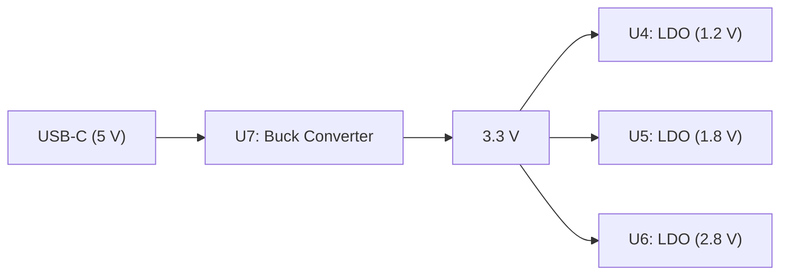
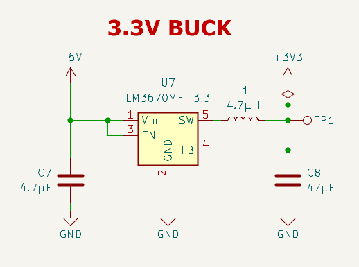
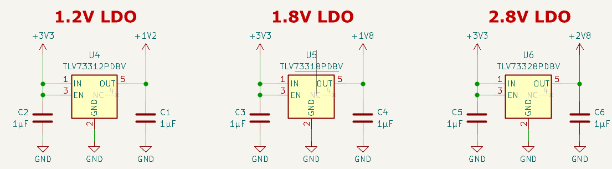
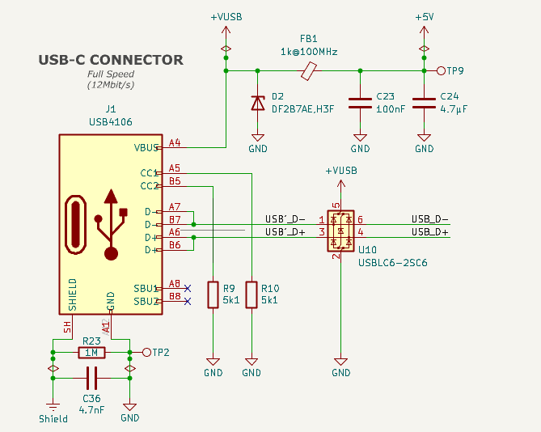
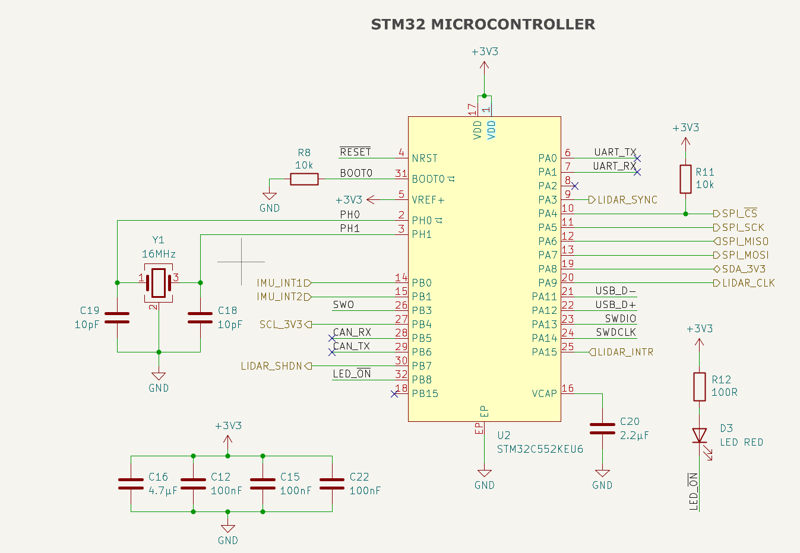
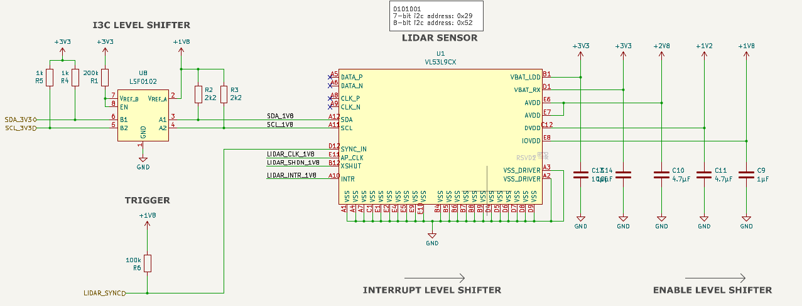
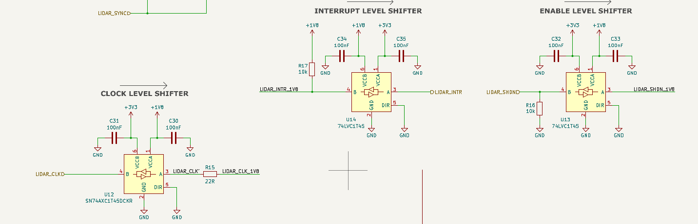

# USB-C LiDAR Node (VL53L9)
### Technical Overview & Capabilities Report

## 1. Board Overview

### 1.1 Project Purpose

### 1.1 Project Purpose

The USB-C LiDAR Node is a compact, low-cost sensing board designed to combine 3D distance measurements with motion data.

It integrates a VL53L9CX LiDAR sensor and an LSM6DSV 6-axis Inertial Measurement Unit (IMU). An STM32 microcontroller is intended to collect the sensor data and transmit it to a host computer via USB-C.

The LiDAR sensor provides spatial distance information, while the IMU measures acceleration and angular velocity. Combining these measurements can help interpret the surrounding environment while the board is moving, making the system useful for robotics and navigation applications.

Potential applications include mobile robotics, small drones, and Simultaneous Localization and Mapping (SLAM) research.

### 1.2 System Architecture

The board consists of two sensors, an STM32 microcontroller, a USB-C interface, and an integrated power supply circuit.

#### System Block Diagram

#### Data Flow

The VL53L9CX measures distances, while the LSM6DSV provides acceleration and angular velocity measurements.

Both sensors are connected to the STM32 microcontroller, which is intended to collect and process their data before transmitting it to a host computer through USB Full-Speed.

According to the schematic, the LiDAR uses SDA/SCL communication signals, while the IMU is connected through an SPI interface.

#### Power Supply

The board is designed to receive 5 V through its USB-C connector.

The power regulation circuit generates the required voltage rails, including 3.3 V, 2.8 V, 1.8 V, and 1.2 V, to supply the different components.

**Sources:**
- [Project README](../README.md)
- [MCU Schematic](../pcb/MCU.kicad_sch)
- [LiDAR Schematic](../pcb/lidar.kicad_sch)
- [IMU Schematic](../pcb/IMU.kicad_sch)
- [Power Schematic](../pcb/power.kicad_sch)

### 1.3 Hardware & Schematic Analysis

#### 1.3.1 Power Circuit

The board is powered through a 5 V USB-C connection. The power supply circuit generates four voltage rails (3.3 V, 2.8 V, 1.8 V, and 1.2 V) required by the different components.

It consists of one buck converter and three Low-Dropout (LDO) regulators.

**Power Supply Architecture**

**A. 3.3 V Buck Converter**

*Figure 1: 3.3 V buck converter schematic.*

The LM3670MF-3.3 (U7) is a switching regulator that efficiently steps down the 5 V input to 3.3 V.

The main components are:

- **U7:** Performs the voltage conversion from 5 V to 3.3 V.
- **L1 (4.7 µH):** Together with C8, forms an LC low-pass filter to smooth the output.
- **C7 (4.7 µF):** Input capacitor that reduces voltage fluctuations.
- **C8 (47 µF):** Output capacitor that reduces voltage ripple.
- **FB (Feedback):** Monitors the output voltage for regulation.
- **EN (Enable):** Connected to 5 V, enabling the regulator when power is applied.
- **TP1:** Test point for measuring the 3.3 V output.

**B. LDO Voltage Regulators**

*Figure 2: 1.2 V, 1.8 V, and 2.8 V LDO regulator circuits.*

Three LDO regulators generate the additional voltage rails from the 3.3 V supply.

| Component | Regulator | Input | Output |
|---|---|---|---|
| U4 | TLV73312 | 3.3 V | 1.2 V |
| U5 | TLV73318 | 3.3 V | 1.8 V |
| U6 | TLV73328 | 3.3 V | 2.8 V |

All three regulators operate according to the same principle:

- **IN:** Receives the 3.3 V supply.
- **OUT:** Provides the regulated output voltage.
- **EN:** Connected to 3.3 V to enable the regulator.
- **GND:** Ground connection.
- **Input/output capacitors (1 µF):** Help stabilize the supply voltages.

Unlike the buck converter, LDOs regulate voltage linearly and do not require an inductor.

**Summary**

The power supply uses a two-stage architecture:

1. A buck converter efficiently generates 3.3 V from the USB 5 V supply.
2. Three LDO regulators generate the additional 1.2 V, 1.8 V, and 2.8 V rails.

This architecture provides the different voltage levels needed by the board's components.

**References**
- [Power Supply Schematic](../pcb/power.kicad_sch)
- [LM3670 Datasheet – Texas Instruments](https://www.ti.com/lit/ds/symlink/lm3670.pdf)
- [TLV733 Datasheet – Texas Instruments](https://www.ti.com/lit/ds/symlink/tlv733p.pdf)

#### 1.3.2 Microcontroller & USB

The board uses an STM32C552KEU6 microcontroller as its central control unit. It interfaces with the LiDAR and IMU sensors and is intended to transfer measurement data to a host computer via USB-C.

**A. USB-C Interface**

*Figure 3: USB-C connector, power input, and protection circuit.*

The USB-C interface provides the 5 V power supply and supports USB 2.0 Full-Speed communication (12 Mbit/s).

The main components are:

| Component | Function |
|---|---|
| J1 (USB4106) | USB-C connector for power and data |
| R9, R10 (5.1 kΩ) | CC resistors for USB-C device detection |
| U10 (USBLC6-2SC6) | ESD protection for USB data lines |
| D2 (DF2B7AE) | Protection of the USB power input |
| FB1 | Ferrite bead to suppress high-frequency noise |
| C23, C24 | Filtering and stabilization of the 5 V supply |
| R23, C36 | Coupling between USB shield and circuit ground |

The USB data lines (D+ and D−) connect to the STM32 through the USB signal nets, with ESD protection provided by U10.

The 5 V supply passes through FB1 before reaching the power regulation circuit described in Section 1.3.1.

**B. STM32 Microcontroller**

*Figure 4: STM32 microcontroller and its main connections.*

The STM32C552KEU6 (U2) operates from the 3.3 V supply and acts as the main interface between the sensors and the host computer.

Its main connections are:

| Interface | Signals | Function |
|---|---|---|
| USB | USB_D+, USB_D− | Communication with the host computer |
| LiDAR | SDA, SCL, CLK | Sensor communication |
| LiDAR Control | SYNC, SHDN, INTR | Synchronization, shutdown, and interrupt signals |
| IMU | SPI_SCK, SPI_MISO, SPI_MOSI, SPI_CS | SPI communication with the IMU |
| IMU Interrupts | IMU_INT1, IMU_INT2 | Sensor event notifications |
| Debug | SWDIO, SWDCLK | Programming and debugging |

Additional components support the operation of the microcontroller:

- **Decoupling capacitors (C12, C15, C16, C22):** Stabilize the 3.3 V supply and reduce noise.
- **R8 (10 kΩ):** Pull-down resistor for the BOOT0 pin.
- **D3 + R12:** Red status LED with a current-limiting resistor.

The microcontroller is intended to collect data from both sensors and provide it to the host through the USB interface.

**References**
- [Microcontroller Schematic](../pcb/MCU.kicad_sch)
- [Project README](../README.md)
- [STM32C552KE – STMicroelectronics](https://www.st.com/en/microcontrollers-microprocessors/stm32c552ke.html)
- [USBLC6-2SC6 – STMicroelectronics](https://www.st.com/en/protections-and-emi-filters/usblc6-2.html)

#### 1.3.3 LiDAR Circuit

The board integrates a VL53L9CX LiDAR sensor (U1) for 3D distance measurements. The circuit includes the sensor's power supply connections, communication interface, and level shifters for communication with the STM32 microcontroller.

**A. LiDAR Sensor & I3C Interface**

*Figure 5: VL53L9CX sensor, power supply connections, and I3C level shifter.*

The VL53L9CX requires several supply voltages:

| Supply | Voltage | Function |
|---|---|---|
| VBAT_LDD, VBAT_RX | 3.3 V | Sensor supply |
| AVDD | 2.8 V | Analog supply |
| DVDD | 1.2 V | Digital supply |
| IOVDD | 1.8 V | Digital I/O supply |

Decoupling capacitors (C9–C14) stabilize the different voltage rails.

The sensor communicates with the STM32 using the SDA and SCL lines. The LSF0102 (U8) is a bidirectional level shifter that converts the signal levels between 3.3 V (STM32) and 1.8 V (LiDAR).

Additional control signals include:

- **SYNC_IN:** External synchronization input.
- **AP_CLK:** External clock input.
- **XSHUT:** Sensor shutdown control.
- **INTR:** Interrupt output to the microcontroller.

**B. Control Signal Level Shifters**

*Figure 6: Clock, interrupt, and shutdown level shifter circuits.*

Three additional level shifters adapt the control signals between the STM32 and the LiDAR sensor.

| Component | Signal | Direction | Function |
|---|---|---|---|
| U12 – SN74AXC1T45 | LIDAR_CLK | 3.3 V → 1.8 V | Clock signal |
| U14 – 74LVC1T45 | LIDAR_INTR | 1.8 V → 3.3 V | Interrupt signal |
| U13 – 74LVC1T45 | LIDAR_SHDN | 3.3 V → 1.8 V | Shutdown control |

Additional components include:

- **R15 (22 Ω):** Series resistor on the clock line.
- **R16, R17 (10 kΩ):** Pull-down and pull-up resistors.
- **C30–C35 (100 nF):** Decoupling capacitors for the level shifters.

**Implementation Note**

The VL53L9CX also provides MIPI data and clock pins (DATA_P/N and CLK_P/N), but these are not connected in the current schematic. The board is designed to use the SDA/SCL interface for sensor communication.

**References**
- [LiDAR Schematic](../pcb/lidar.kicad_sch)
- [VL53L9CX Datasheet](DS_vl53l9cx.pdf)
- [Project README](../README.md)
