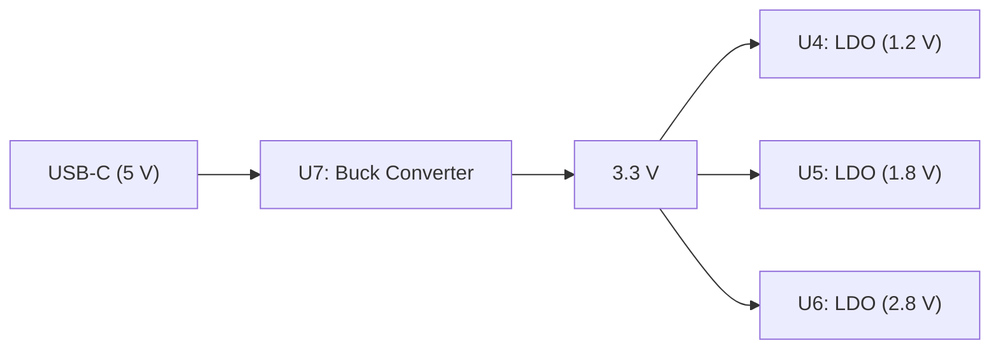

# USB-C LiDAR Node (VL53L9)
### Technical Overview & Capabilities Report

## 1. Board Overview

### 1.1 Project Purpose

### 1.1 Project Purpose

The USB-C LiDAR Node is a compact, low-cost sensing board designed to combine 3D distance measurements with motion data.

It integrates a VL53L9CX LiDAR sensor and an LSM6DSV 6-axis Inertial Measurement Unit (IMU). An STM32 microcontroller is intended to collect the sensor data and transmit it to a host computer via USB-C.

The LiDAR sensor provides spatial distance information, while the IMU measures acceleration and angular velocity. Combining these measurements can help interpret the surrounding environment while the board is moving, making the system useful for robotics and navigation applications.

Potential applications include mobile robotics, small drones, and Simultaneous Localization and Mapping (SLAM) research.

### 1.2 System Architecture

The board consists of two sensors, an STM32 microcontroller, a USB-C interface, and an integrated power supply circuit.

#### System Block Diagram

#### Data Flow

The VL53L9CX measures distances, while the LSM6DSV provides acceleration and angular velocity measurements.

Both sensors are connected to the STM32 microcontroller, which is intended to collect and process their data before transmitting it to a host computer through USB Full-Speed.

According to the schematic, the LiDAR uses SDA/SCL communication signals, while the IMU is connected through an SPI interface.

#### Power Supply

The board is designed to receive 5 V through its USB-C connector.

The power regulation circuit generates the required voltage rails, including 3.3 V, 2.8 V, 1.8 V, and 1.2 V, to supply the different components.

**Sources:**
- [Project README](../README.md)
- [MCU Schematic](../pcb/MCU.kicad_sch)
- [LiDAR Schematic](../pcb/lidar.kicad_sch)
- [IMU Schematic](../pcb/IMU.kicad_sch)
- [Power Schematic](../pcb/power.kicad_sch)

### 1.3 Hardware & Schematic Analysis

#### 1.3.1 Power Circuit

The board is powered through a 5 V USB-C connection. The power supply circuit generates four voltage rails (3.3 V, 2.8 V, 1.8 V, and 1.2 V) required by the different components.

It consists of one buck converter and three Low-Dropout (LDO) regulators.

**Power Supply Architecture**

**A. 3.3 V Buck Converter**

*Figure 1: 3.3 V buck converter schematic.*

The LM3670MF-3.3 (U7) is a switching regulator that efficiently steps down the 5 V input to 3.3 V.

The main components are:

- **U7:** Performs the voltage conversion from 5 V to 3.3 V.
- **L1 (4.7 µH):** Together with C8, forms an LC low-pass filter to smooth the output.
- **C7 (4.7 µF):** Input capacitor that reduces voltage fluctuations.
- **C8 (47 µF):** Output capacitor that reduces voltage ripple.
- **FB (Feedback):** Monitors the output voltage for regulation.
- **EN (Enable):** Connected to 5 V, enabling the regulator when power is applied.
- **TP1:** Test point for measuring the 3.3 V output.

**B. LDO Voltage Regulators**

*Figure 2: 1.2 V, 1.8 V, and 2.8 V LDO regulator circuits.*

Three LDO regulators generate the additional voltage rails from the 3.3 V supply.

| Component | Regulator | Input | Output |
|---|---|---|---|
| U4 | TLV73312 | 3.3 V | 1.2 V |
| U5 | TLV73318 | 3.3 V | 1.8 V |
| U6 | TLV73328 | 3.3 V | 2.8 V |

All three regulators operate according to the same principle:

- **IN:** Receives the 3.3 V supply.
- **OUT:** Provides the regulated output voltage.
- **EN:** Connected to 3.3 V to enable the regulator.
- **GND:** Ground connection.
- **Input/output capacitors (1 µF):** Help stabilize the supply voltages.

Unlike the buck converter, LDOs regulate voltage linearly and do not require an inductor.

**Summary**

The power supply uses a two-stage architecture:

1. A buck converter efficiently generates 3.3 V from the USB 5 V supply.
2. Three LDO regulators generate the additional 1.2 V, 1.8 V, and 2.8 V rails.

This architecture provides the different voltage levels needed by the board's components.

**References**
- [Power Supply Schematic](../pcb/power.kicad_sch)
- [LM3670 Datasheet – Texas Instruments](https://www.ti.com/lit/ds/symlink/lm3670.pdf)
- [TLV733 Datasheet – Texas Instruments](https://www.ti.com/lit/ds/symlink/tlv733p.pdf)

